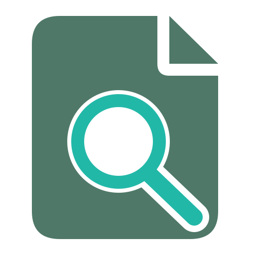
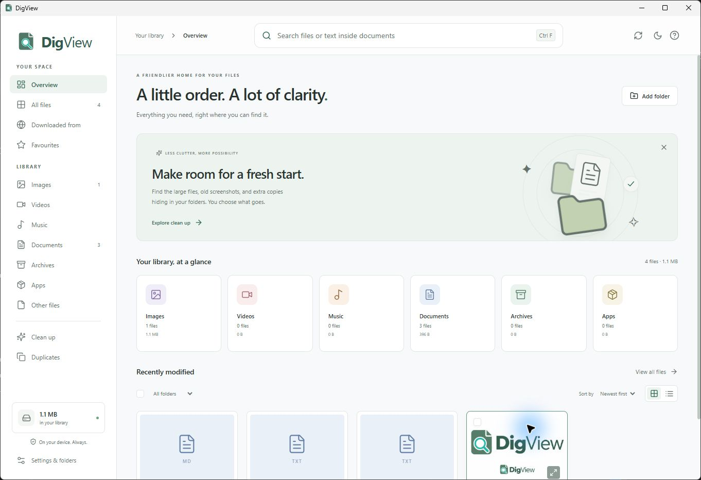
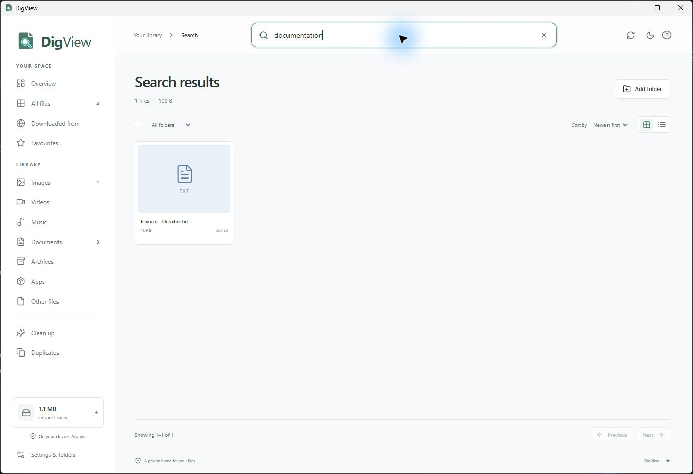
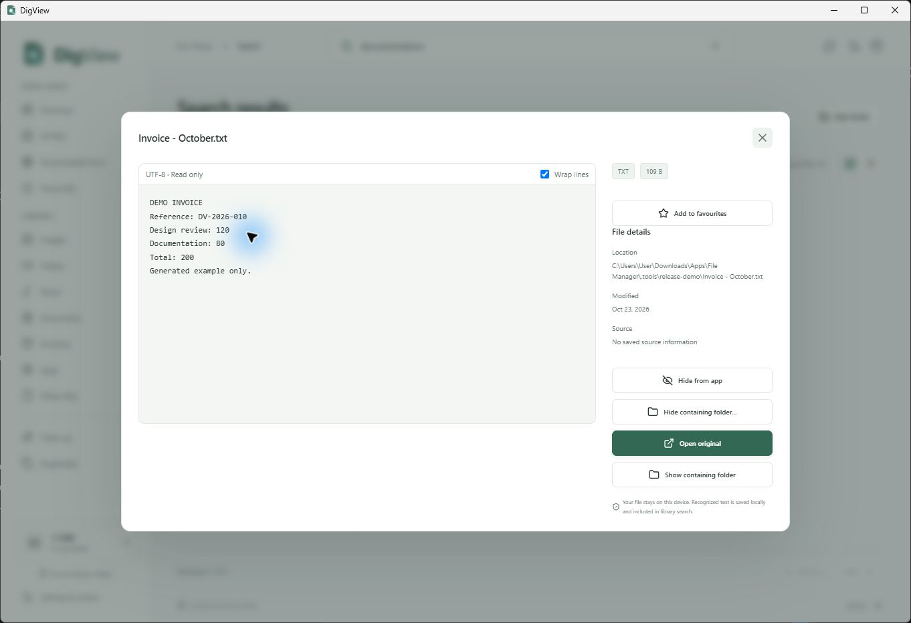
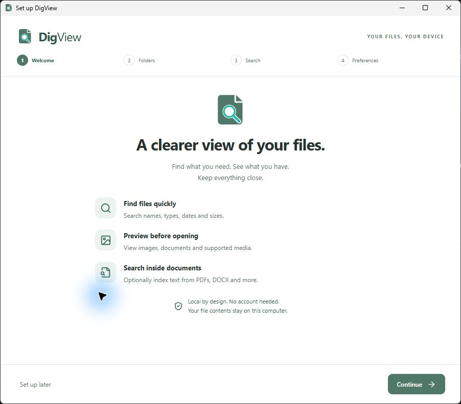

<p align="center">
  
</p>

# DigView

**Find, preview and organize your files.**

DigView is a private file library for Windows. Find files by name or text inside supported documents, preview them, and keep your folders organized—all on your device, with no account required.

Windows beta · [MIT license](LICENSE) · Built with Tauri, Rust, React and SQLite



*Actual Windows app capture with generated demonstration files. Screenshots show only the DigView window.*

## What you can do

- **Find files:** search names and use type, date, size and folder filters.
- **Search document text:** optionally index embedded text in PDF, DOCX, TXT and supported code files.
- **Preview locally:** view images, PDFs, text/code and supported audio/video without leaving the app.
- **Recognize image text:** run local OCR on selected images and include saved text in search.
- **Review clutter:** find exact duplicates and cleanup candidates; review before sending files to the OS trash.
- **Make it yours:** favourites, grid/list views, light/dark/system appearance and optional tray/startup preferences.

You choose which folders DigView indexes. Originals stay in place. File contents remain on your device; cloud telemetry is disabled by default.

## Search inside documents

Enable **Search inside documents** during setup or in Settings, then let indexing finish. Search can match supported document text as well as file names.



*In this example, “documentation” finds the generated invoice through its text, although the word is absent from the filename.*



## Get started on Windows

DigView is currently a development beta. To create your own executable and installer, follow [BUILD-WINDOWS.md](BUILD-WINDOWS.md) and run **Build-Windows.cmd** from the project root.

Build output is written to a timestamped folder under `releases/builds/`. Run its installer, or keep `THIRD_PARTY_NOTICES.txt` beside the direct `digview.exe`. Local beta packages are unsigned. Build files are not included in this source repository.

On first launch:

1. Choose suggested locations or a custom folder.
2. Decide whether to enable document text indexing.
3. Save your appearance/background preferences and open the library.

When upgrading from an earlier local build, quit its tray process first. Windows data-import code preserves the original library; actual installer upgrade and broader migration validation remain pending. See [installer notes](docs/INSTALLER.md).

<details>
<summary>First-run setup</summary>



</details>

## Current limits

- Windows is the currently validated runtime. macOS/Linux runtime support is unverified.
- Document search matches indexed words; semantic search and AI model downloads are not included.
- Scanned PDFs need separate OCR. Encrypted, oversized or unsupported documents may be skipped.
- Media playback/thumbnails depend on installed Windows codecs.
- Installer upgrade/uninstall and broad migration scenarios still need validation. Successful app startup does not establish all of those outcomes.

## Development

Requirements: Node.js 22.13+ on the 22.x line or 24+, Rust 1.90+, and the [Tauri prerequisites](https://v2.tauri.app/start/prerequisites/).

```sh
npm install
npm run tauri dev
```

`npm run dev` runs a browser demonstration with example files. Desktop mode uses the folders you select.

| Command | Purpose |
| --- | --- |
| `npm test` | Frontend logic tests |
| `npm run native:test` | Native engine tests |
| `npm run build` | Frontend type check and bundle |
| `npm run build:windows` | Windows executable and installer |
| `npm run native:video` | Explicit Windows video-codec integration check |

[Usage](docs/USAGE.md) · [Feature scope](docs/FEATURES.md) · [Architecture](docs/ARCHITECTURE.md) · [Validation](docs/VALIDATION.md)

## Roadmap

Planned contributor tasks: **optional Gemma download and local semantic search**, plus **automatic app updates**. These are not available in the current beta. See [TODO.md](TODO.md) for scope and acceptance criteria.

## Contributing

Contributions are welcome: read [CONTRIBUTING.md](CONTRIBUTING.md), open an issue, or submit a pull request from your fork. Security reports should follow [SECURITY.md](SECURITY.md).

## License

DigView's own code is [MIT licensed](LICENSE): use, modify, distribute and sell it under the license conditions. Dependencies retain their [own terms and notices](docs/THIRD_PARTY.md).
